# Breakfast

*Works with [Autodarts](https://autodarts.io).*

Breakfast is a self-hosted companion for your Autodarts board. It shows a live scoreboard on any screen in
the room, announces the game with a built-in voice caller, adds game modes and practice drills beyond X01,
keeps lifetime statistics and can drive LED displays over MQTT. It connects to the Autodarts cloud with your
own account and needs no other add-on.

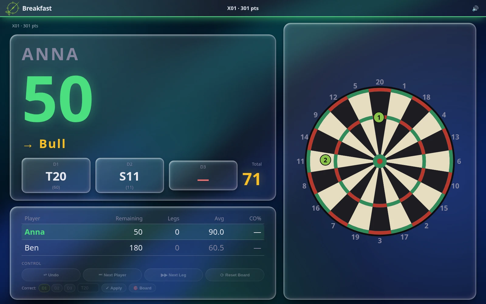

## Features

- [Live scoreboard and TV view](#tv-view): full screen on a TV or tablet, with checkout suggestions and a live dartboard
- [Games and drills](#games-and-drills): X01 with tournaments, Elimination, Target Battle, Killer, Field Training, a Warm-up, Black Belt and a Checkout Trainer
- [Voice caller](#voice-caller-and-voice-packs): announces the game, with English and German voice packs and an editor for your own
- [Statistics](#statistics): averages, records, heatmaps and leaderboards
- [Achievements](#achievements): badges for milestones such as a 180 or a nine-dart leg
- [Online Elimination](#online-elimination): play one Elimination match together with players at other locations
- [Circle of friends](#circle-of-friends): installations of a group of friends share their matches, so a player has his statistics and achievements wherever he plays
- [Usage reports](#usage-reports): optional anonymous usage and error reports, off by default
- [MQTT output](#mqtt) for LED strips and Home Assistant, optional
- [Installation](#installation) on Windows, with Docker or from source, with [self-update](#updates)
- [Settings](#web-ui) in the browser, English or German interface

## How it works

```
Autodarts cloud ── Breakfast ── local board connection (dart positions)
                      │
          ┌───────────┼───────────────┐
       Web UI        MQTT          Voice caller
   (phone, tablet,  (LED strips,   (announcements play in a
     TV, PC)         Home Assistant) browser on /audio, on the
                                     device with the speakers)
```

## Installation

### Windows

Download `breakfast-windows-vX.Y.Z.zip` from the latest release. It contains a single folder with
`breakfast.exe`; Python and Docker are not needed.

1. Unzip it, for example to `C:\Breakfast`, and start `breakfast.exe`. Your browser opens the Settings page:
   enter your Autodarts account under **Autodarts Source**, save, and press **Restart**.
2. Windows asks once whether Breakfast may use the network. Allow it for private networks so that a TV or
   phone can reach `http://<pc>:8080`.
3. Optional: run `install-autostart.ps1` with PowerShell to start Breakfast when you log in
   (`remove-autostart.ps1` undoes it).

Everything Breakfast stores lives in the `data` folder next to `breakfast.exe`; back it up to keep your
statistics. The program is not signed: if Windows says "Windows protected your PC", choose **More info**,
then **Run anyway**.

### Docker

```bash
git clone https://github.com/3lefeint/breakfast26.git
cd breakfast26
mkdir -p data/sessions data/sounds
cp config.toml.example data/config.toml   # fill in your values
docker compose up -d
```

Autodarts itself keeps running natively on the host; only Breakfast is containerized. The header of
`docker-compose.yml` explains the one setting Breakfast needs to reach the board from inside the container
(`board_ws_url`).

### From source

Needs Python 3.11+ and Node.js 22+.

```bash
git clone https://github.com/3lefeint/breakfast26.git
cd breakfast26
python -m venv .venv
source .venv/bin/activate          # Windows: .venv\Scripts\activate
pip install -r requirements.txt
(cd frontend && npm ci && npm run build)
cp config.toml.example config.toml   # fill in your values
python main.py
```

To run it as a service on Linux, copy `systemd/breakfast.service` to `/etc/systemd/system/`, replace
`YOUR_USER` and the paths in it, and run `sudo systemctl enable --now breakfast`.

Then open `http://<host>:8080`.

## Configuration

Breakfast reads `config.toml` (from the project folder, or from `data/` for Docker and Windows). Every option
is documented in `config.toml.example` and can be changed in the browser under **Settings**. The minimum
is your Autodarts account:

```toml
mode = "direct"

[direct]
email    = "user@example.com"
password = "your-password"
board_id = "xxxxxxxx-xxxx-xxxx-xxxx-xxxxxxxxxxxx"

[web]
port = 8080
```

The other sections (`[audio]`, `[mqtt]`, `[stats]`, `[online]`, `[telemetry]`, `[updates]`, `[logging]` and more) are described in
`config.toml.example`. MQTT and statistics can be switched off (`[mqtt] enabled = false`, `[stats] db = "none"`).

With Docker the port is the one the host publishes, `BREAKFAST_PORT` in an untracked `.env` file next to
`docker-compose.yml` (default 8080); Settings → Dev sets it, checks that it is free and recreates the container.

## Using Breakfast

### Web UI

Open `http://<host>:8080` from any device on your network. **Play** sets up and starts the games and drills,
**Players** lists the players with their profiles and achievements and merges a player that was created twice (for example after a name change) into another one or deletes a player, **Stats** shows the statistics, and
**Settings** edits everything in `config.toml` without touching the file, in tabs: **Appearance** (language,
palette with its accent color, animated background), **Audio & Voice** (caller, voice-pack editor, achievement
sounds), **Connections** (board data source, MQTT, online play) and **System** (updates, usage reports, statistics).
It stays available while a game runs, with a link back to the game. A setting that needs a restart is listed in a
notice with a Restart button. The TV view (`/#tv`) and the `/audio` page are described below.

<table>
<tr>
<td width="50%">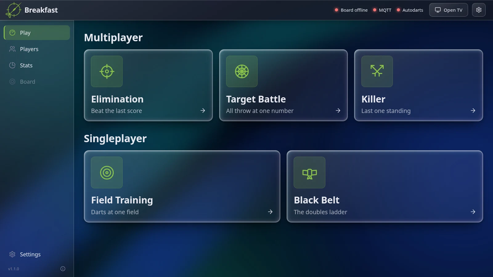</td>
<td width="50%">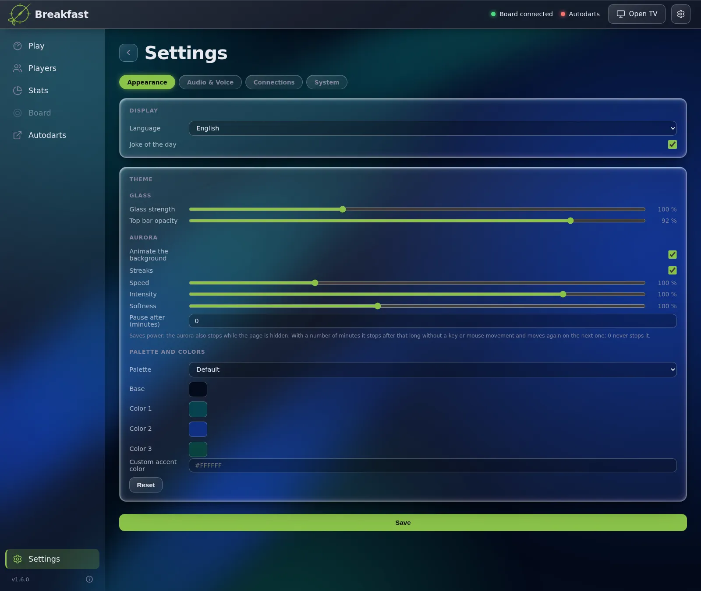</td>
</tr>
</table>

### TV view

Press **Open TV** in the top bar (or open `http://<host>:8080/#tv`) on a display near the board. Starting a game opens it by itself. It shows whichever game is running. For X01 that
is the scoreboard with the remaining score, the suggested checkout (with a "Bogey" badge for scores that
cannot be checked out) and the live average, 180s and checkout rate next to each player. With the local
board connection, a dartboard shows where each dart of the current turn landed.

The X01 view also controls the board: undo the last detected throw, skip to the next player or leg, and
reset the board. To correct a misread dart, or to enter one the board did not see, tap its box and press the spot on the
dartboard (a magnifier shows it); the dart is stored where you let go.

### Games and drills

- **X01**: played in Autodarts as usual, with Breakfast adding the scoreboard, checkout suggestions and voice calls, or
  started in Breakfast, which then counts the darts from the board. Choose the base score, double or master in and
  out, the legs to win and any number of players; a bull-off or a draw decides who starts, and the first thrower moves
  one place on with every leg. With a max rounds limit (15, 25 or 50, off by default) a leg that nobody has checked out
  after that many rounds is decided by a bull-off, the closest dart wins; such a leg counts as a win but stays out of
  the best-leg statistics. The match is stored like any other X01 match, and undo, the Next button and corrections
  of a dart work as in Elimination.
  A summary of the match (averages, the remaining score per turn, the darts on the board and every turn with the
  fields hit) opens from the result on the TV view and from the match list of the X01 statistics; it can be saved as an image.
- **X01 tournament**: single elimination in the X01 mode of Breakfast. Pick the players (a new one can be added on the
  spot), the base score, the in and out mode, the max rounds, a bull-off or a draw for who throws first, and the legs to win per round,
  so the final can be longer than the first round. The bracket is drawn at random as soon as there are two players, byes
  included (it is rounded up to the next power of two, a bye moves on without a match), and any two seats can be swapped
  by hand. After a match its result waits half a minute, then the
  next pairing starts by itself; the TV view shows the whole bracket between the matches. The tournament is stored, so it
  survives a restart (a match in play is offered again, see [Updates](#updates)), and its matches count in the statistics like any X01 match.
- **Elimination**: any number of players, each with a number of lives. Every turn has to beat the total of
  the previous turn, otherwise the player loses a life; the last player with lives left wins. Turns can be
  corrected and undone, and a dart the board did not detect can be entered by hand and the Next button ends a turn without pulling the darts. An optional hint on the TV view marks the fields on the board that still beat the
  target.
- **Target Battle**: in each round, all players throw at the same target number, and only a dart on that
  number scores. A wheel picks a random target every round, or you set the order yourself. Single, double and
  triple score 1, 2 and 3 points, or you practice with only one of them counting.
- **Killer**: every player gets a number. Hitting the double of your own number makes you a killer, and a
  killer takes a life from an opponent by hitting the double of that opponent's number. The last player left
  wins.
- **Computer opponent**: Elimination, Killer, X01 and X01 tournaments can be played against the computer, so one
  person can play a full match on the board. Add it on the setup page with a level from 10+ to 110+ (its
  three-dart average when it aims at the triple 20); X01 and the tournaments use five stages from beginner to
  pro instead (about 90 % of a beginner's darts land on the board, all of a pro's, and the pro hits the triple
  20 about every third dart). It throws its three darts with short pauses, and the TV view,
  voice calls, undo and corrections work as for a player. In X01 it aims at the triple 20 until it can finish,
  then follows the checkout chart for the chosen out mode. The match is stored, but the computer has no stats,
  leaderboard entries or achievements.
- **Field Training**: one player throws a fixed number of darts at a single field, a number or the bull. The
  result shows the points, the hit rate and a rating.
- **Warm-up**: a round over every segment of the board for one player. Throw at each field until it is hit: the
  big singles from 1 to 20, the bull, the small singles from 1 to 20, the bull, the doubles from 1 to 20, the
  bull, the triples from 1 to 20 and the bull's eye. Switch on only the stations you want, for example the big
  singles and the triples, or leave them all; the order stays, the bull comes between the stations. There is no limit of darts per field, and after a hit the next field
  is up, also for the darts left in the turn. The board lights the part of the field that is up, the result
  shows the darts per station and the fields that took the most, and compares the run with your earlier ones
  over the same stations.
- **Black Belt**: a doubles drill for one player. Hit D1 to D20 and finally the bull's eye, in order (or from
  D20 down to D1). If a field is not hit with its darts, you start again from the beginning. You earn the
  belt by getting through the whole ladder in one go.
- **Checkout Trainer**: three exercises for finishing. *Random checkout* draws a score you can finish with
  three darts, and you throw it on the board (the standard route can be shown while you throw). The Stats page
  shows which scores work and which do not. *Route quiz* and *Setup shots* are played on a virtual board
  without darts, also on a phone: tap the first dart of a route, or tap the darts that set up a finish and see
  what is left and what that rest allows.

<table>
<tr>
<td width="33%">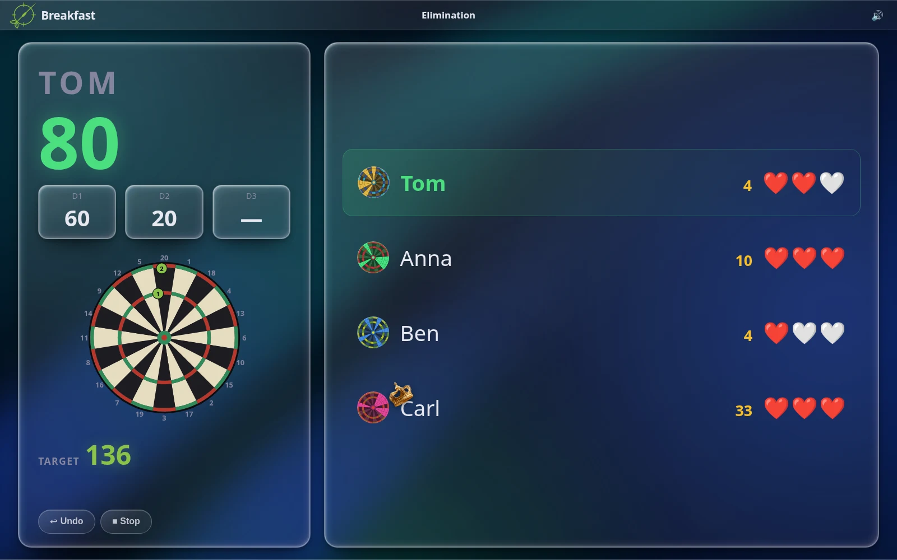<br><sub>Elimination</sub></td>
<td width="33%">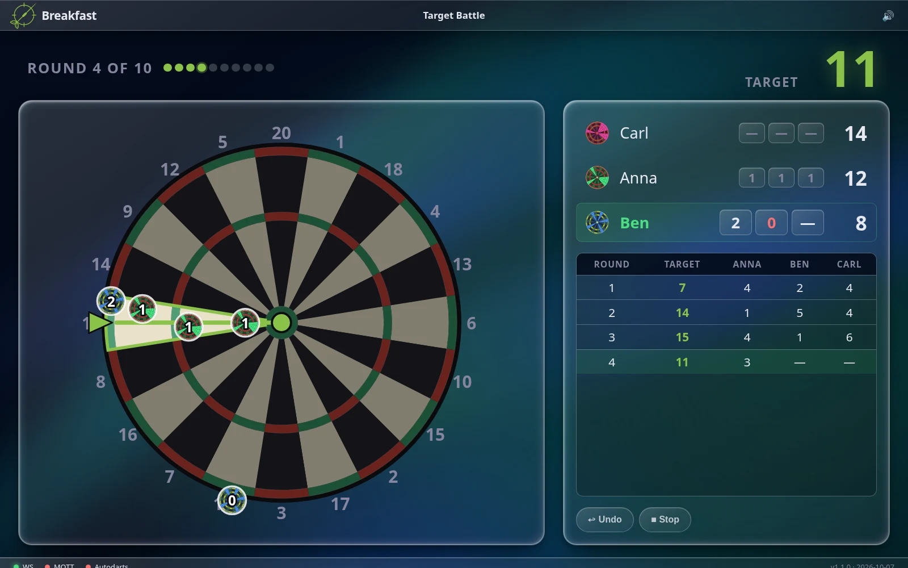<br><sub>Target Battle</sub></td>
<td width="33%">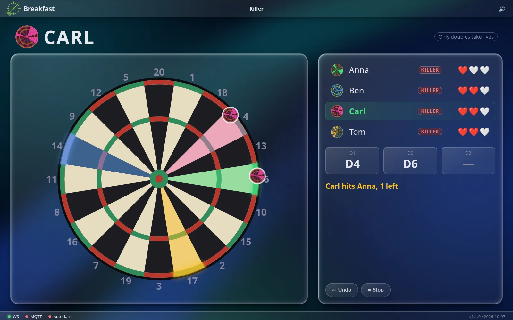<br><sub>Killer</sub></td>
</tr>
<tr>
<td width="33%">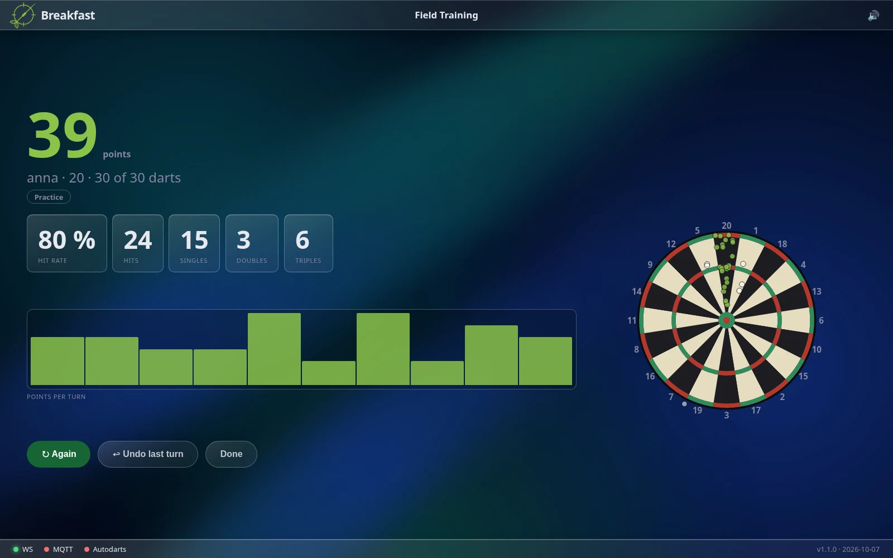<br><sub>Field Training</sub></td>
<td width="33%">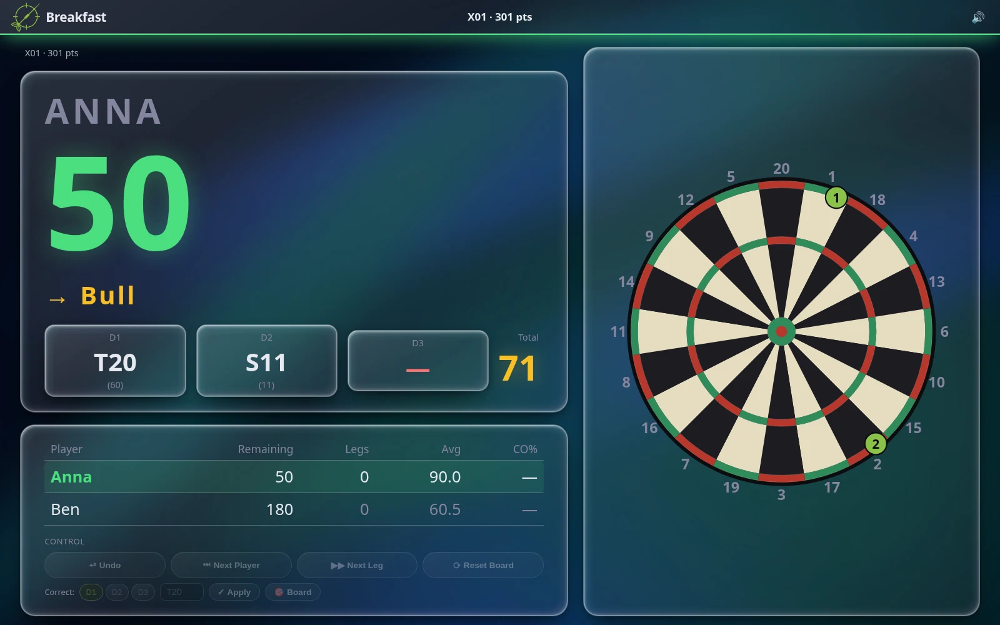<br><sub>Black Belt</sub></td>
<td width="33%">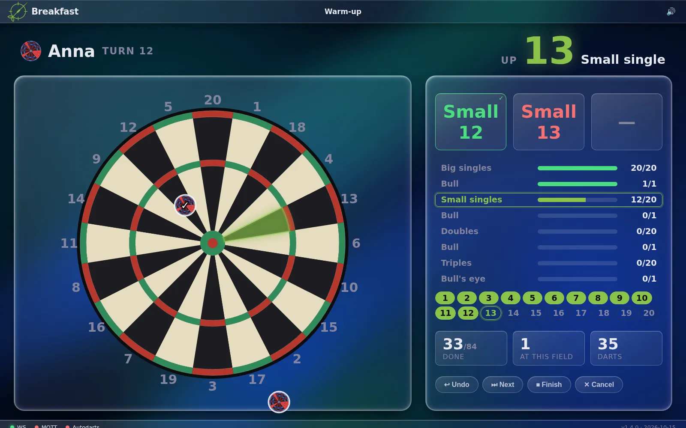<br><sub>Warm-up</sub></td>
</tr>
</table>

### Voice caller and voice packs

With `[audio] dir` set, Breakfast announces X01 matches itself: the start and end of legs and matches, every
dart, turn totals, checkouts ("you require ...") and busts. The sound plays in a browser tab on `/audio`.
Open it on the device that is connected to the speakers, click **Enable sound** once and leave the tab
open.

A voice pack is a folder of plain `key.mp3` files. Two ready-made packs, English (`tools/voicepack_ryan.toml`)
and German (`tools/voicepack_leni.toml`), can be generated from text with `edge-tts` and `ffmpeg`:

```bash
pip install edge-tts
python tools/generate_voicepack.py tools/voicepack_ryan.toml --out <audio dir>/profiles/ryan
# then set [audio] profile = "ryan"; your own files stay as fallback
```

To change a single entry, use **Settings → Audio & Voice → Voice Pack**: pick a group, enter a key and one or more variants,
listen to a preview and save. [VOICE_PACKS.md](VOICE_PACKS.md) lists every call key, explains where the
names of your players are kept, and shows how to record a pack of your own. Player names are stored in lower case and
shown in upper case, so the voice file of a player is `<name>.mp3` whatever the spelling when the player was created.
Breakfast also fills in the voice files that are missing, for example for a new player, by itself every 10 minutes
(`[audio] auto_generate_minutes`, `0` switches it off), and uses a new file without a restart.

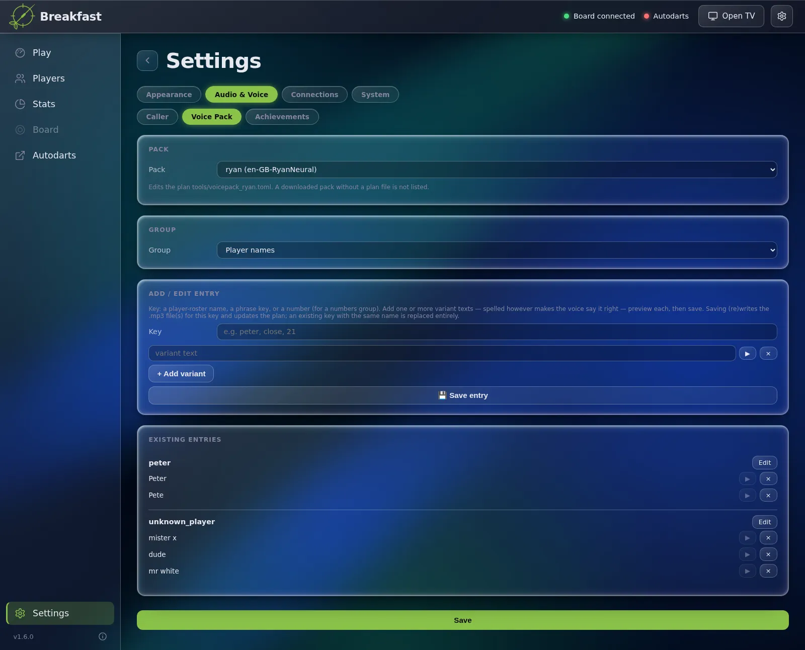

### Statistics

Every turn is stored locally in `stats.db`. The **Stats** page has a view for each game mode with records,
comparisons between players and recent matches; for X01 also per-player details such as a score histogram
and a heatmap of the board. Leaderboards rank players by average, 180s and checkout rate.
A game that is cancelled before its end is not stored, and a match can be deleted from the list of recent matches
(it asks for the location PIN when one is set).

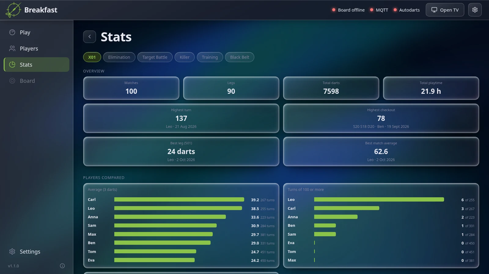

### Achievements

Players earn achievements in their matches: a bullseye, a 180, a big checkout, streaks, a nine-dart leg and
many more, some with several tiers and some secret. They appear as badges in the player profile. Only
matches played after achievements were first enabled on your installation count. Most are announced as soon
as they happen and made final when the match ends, so a game with many players does not end with a long run
of banners.

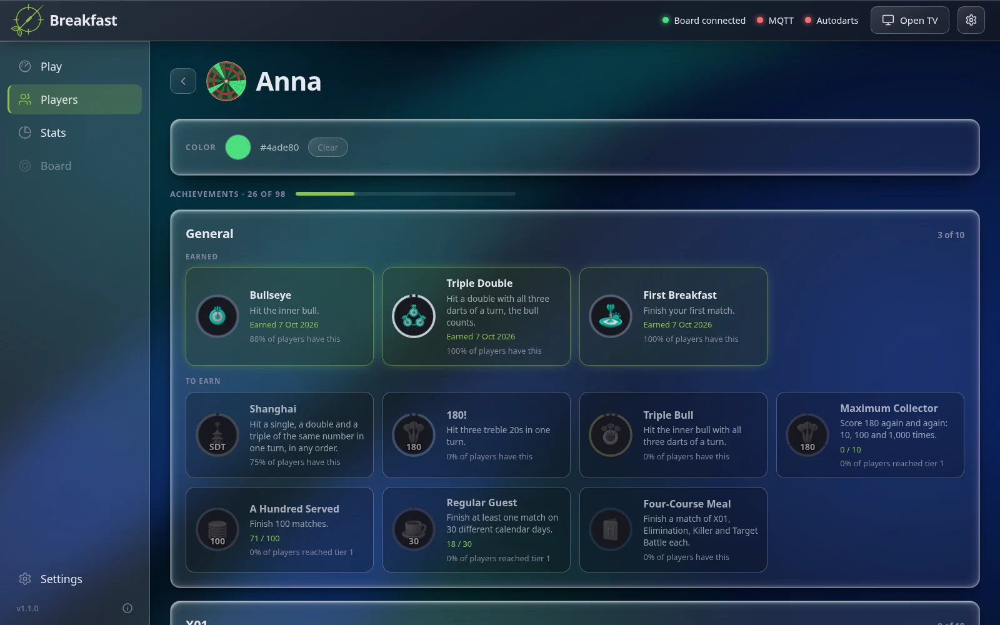

When a match ends, the TV announces what was earned, and the result page of the match lists it (also in the details of the
match in the Stats page):

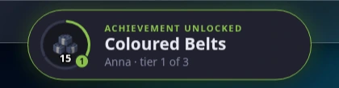

### Online Elimination

Play one Elimination match together with players at other locations, each on their own Breakfast
installation. One site hosts the match; the others join with its join code and a shared password, or, if
the sites are linked, with one click. Each site adds its own players and says it is ready, and the host sets the
lives and the order. A voice chat for the sites of a match opens in its own browser tab (*Voice chat* in the lobby and on the TV view): it runs on the relay's secure page, directly between the browsers, and a headset avoids echo.
Online play needs a relay (a small Cloudflare Worker, see [relay/README.md](relay/README.md)) and
`[online] relay_url`; without it, online play is off. Every site stores the whole match, the players of the other sites
as guests (`name@site`): they appear in the match but have no entry in the Players tab, no ranking and no achievements here. A guest the circle admin mapped to a local player counts as that player, also for matches stored before.
The last turn can be undone or corrected, a dart of it or its total, also in an online match: the site that threw the turn does
it, and the other sites play it again.

**Linked locations.** Under Settings → Connections, *Location Online Settings* registers the installation at
the relay with a name and a local PIN. *Create invitation* gives a code for another location, which pastes it under
*Accept an invitation*; the two are linked from then on. A match that a registered location opens then shows up
under *Matches of linked locations* on the Online page of the linked ones, who join it without a password. A host
who leaves the password empty is joinable only by linked locations.

### Circle of friends

A group of friends with several Breakfast installations (clubs, homes) can form a **circle**: a finished X01 or Elimination match
goes to the installations the circle's admin chose for the players in it, so a player has his statistics, match list and
achievements on every installation he plays on, wherever the match was played. It needs the same relay as online play
([relay/README.md](relay/README.md)) and an installation that is registered as a location (see *Linked locations* above); the
admin approves each installation once.

- **For everyone:** Settings → Connections → *Circle of friends* has a switch for the sync, shows when matches were last sent and
  fetched and how many wait, and *Send all matches* hands over the matches played before (a large history takes some days, the relay
  limits the daily amount). Imported matches are stored like your own and earn achievements for the players the admin matched to
  local players, without a banner or a sound; other players appear as guests (`name@site`). The color of a player and his
  private voice entries (the pronunciation of his name, see *Voice caller and voice packs*) follow him to the installations
  that know him, the latest change wins; the voice files are made again at each installation.
- **For the admin:** the admin area (`#admin` in the Home app, a sidebar entry appears once a relay address is stored in the
  browser) logs in to the relay with the admin password, which is stored only as a salted hash at the relay and never on an
  installation. It approves the installations, keeps the players of the circle, matches the players of each installation to them
  and ticks the installations that get the matches of each player. It also shows the sync state, the newest records, the usage
  reports and how close the relay is to the free plan of Cloudflare. *Fetch again* makes an installation fetch everything meant for
  it once more, after a rule or a match of players changed.

Matches are sent as plain JSON and the relay can read them. A site can switch the sync off at any time; what it sent stays at the
other sites.

### Usage reports

Breakfast can report errors and basic usage anonymously, to help find problems on setups other than the
developer's. It is off by default; switch it on under Settings → System → **Usage reports**. A report holds the
version, the platform, the game modes played with their duration, and the errors that occur (type and code
location), sent under a random installation ID. It never holds player names, scores, IP addresses or error
messages. **Show what is sent** lists the queued and the recently sent reports. The reports go to the relay
(`[telemetry] url`, by default `[online] relay_url`, see [relay/README.md](relay/README.md)).

### MQTT

Breakfast can publish its state to an MQTT broker, for example to drive ESPHome LED strips or to feed Home
Assistant (configured in `[mqtt]`; the ESPHome config for the LED display and the Home Assistant entities are in `ESPHome/`). MQTT is optional, everything else
works without it. All topics are published under a base topic (default `autodarts`):

| Topic | Value |
|-------|-------|
| `autodarts/current/...`, `autodarts/match/...`, `autodarts/players/<index>/...`, `autodarts/board/status` | the active player and their darts, the match, the remaining score of each player and the board status |
| `autodarts/<game>/active`, `.../state` | for `elimination`, `target_battle`, `killer`, `field_training`, `black_belt`, `warm_up` and `checkout_training`: whether the game is running, and its full state as retained JSON |
| `autodarts/<game>/current/...`, `.../last_turn/...`, `.../events/...` | the turn in progress, the last finished turn and one-time events of the game |
| `autodarts/<game>/command` | Breakfast listens here: JSON `{"action": ...}` to start, stop, undo or correct a game |

## Updates

- **Windows**: Settings → System → **Updates** checks for a newer GitHub release, downloads it, verifies its SHA-256
  checksum and installs it. The old version is kept until the new one passes its health check, and is
  restored if it does not.
- **Docker**: the `updater` service in `docker-compose.yml` provides the same function under Settings →
  System → **Updates**: it pulls the newest release tag, rebuilds, restarts and rolls back if the new build is not
  healthy. Remove the service if you do not want self-update.

Breakfast looks for a newer release once after the start and then every 24 hours: a dot on the Settings button, a
"vX.Y.Z available" chip at the top of Settings and a one-time notice in the corner (not in the TV view, not while a game
is running, not again for a version you dismissed). Installing stays manual. `[updates] check = false` (or Settings →
System → Updates) switches the automatic check off.

With `[updates] auto_install = true` (or Settings → System → Updates → Install updates automatically, off by default) a newer
patch or minor release is installed by itself after the start and at 04:00 every day (in the `[stats]` time zone, else the
server's). It is skipped while a game is running, a new major version is only announced, and a version that was tried
before is not tried again automatically.

Before every update the statistics database is copied to a `backups` folder next to it (the last three are kept), and a
rollback puts that copy back; Settings → System → Updates shows when the latest one was made.

After an update the changes of the new version are shown once in a dialog (once per browser, not in the TV view, not
while a game is running); Settings → System → Updates reopens them.

A match of X01, a tournament, Elimination or Killer that is in play is saved after every change. After a restart or an
update the Home app offers to **Resume** it or to **Discard** it; nothing resumes by itself, and the match goes on at
the start of the turn that was in play. The Restart and Install buttons warn when a game is running.

## Security

Breakfast has no login. Anyone who can reach its web port can watch games, start and stop them, change the
settings and restart the app. Run it only on a trusted home or club network and do not expose port 8080 to
the internet. If you need remote access, put your own authentication in front of it (a VPN or a reverse
proxy with a login). The Autodarts and MQTT credentials are stored in plain text in `config.toml`, so keep
that file private. To report a vulnerability, see [SECURITY.md](SECURITY.md).

## Acknowledgements

- The calling behavior, the call keys and the voice-pack format are modeled on the darts-caller project, so
  its voice packs work unchanged.
- Breakfast is an independent project and not affiliated with or endorsed by Autodarts. It talks to the
  Autodarts cloud with your own account; check Autodarts' terms of use for your setup.

## License

MIT, see [LICENSE](LICENSE).
